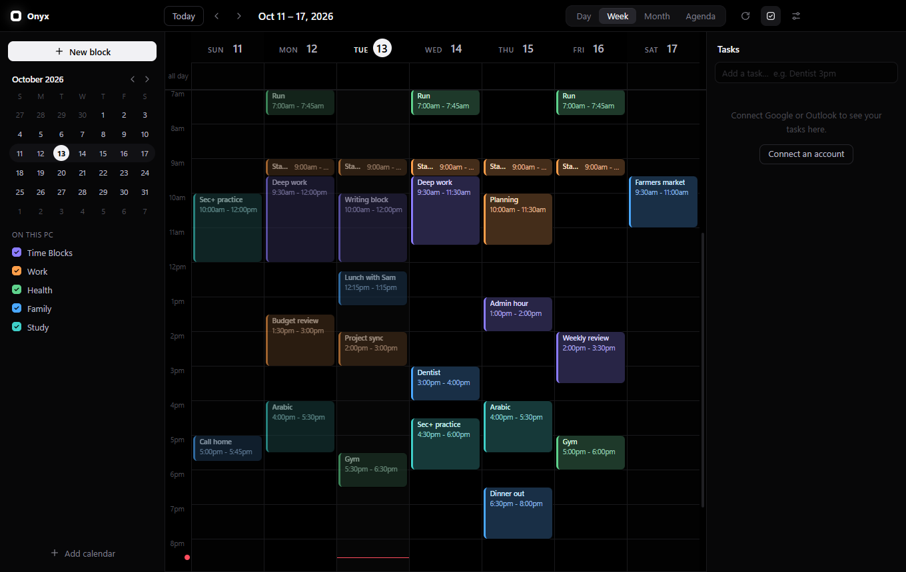
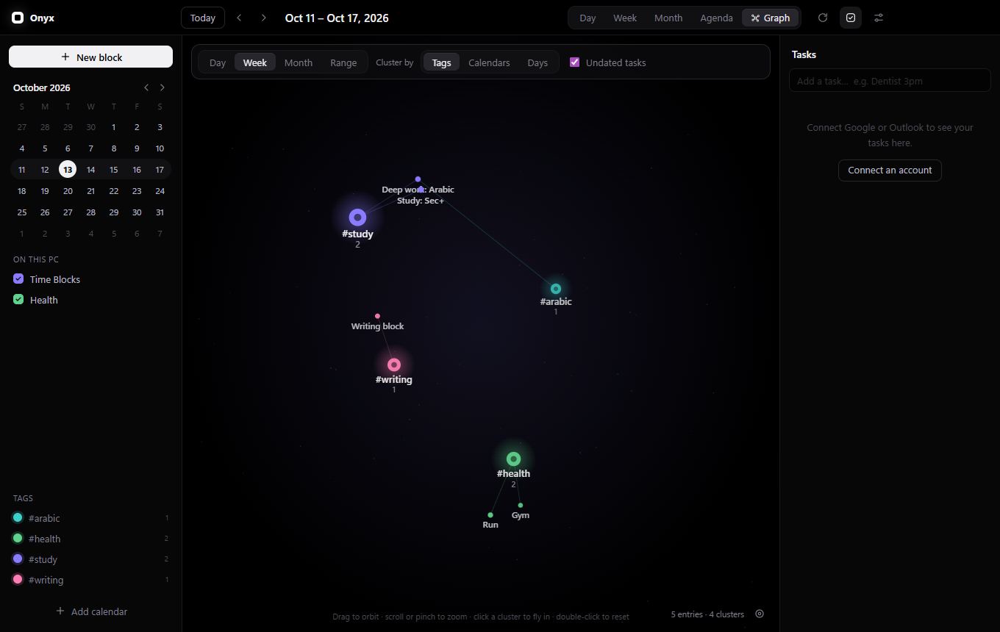

# Onyx Calendar

A black, fast calendar for Windows and Android that puts everything in one place:

- **One master calendar.** Google Calendar, Outlook, subscribed calendar links and local time blocks, merged. A sidebar switches each calendar on or off.
- **Popups that ring.** When the Pi phones you about something, a popup appears over everything (even with Onyx in the tray) showing what is coming and when, ringing like a phone; another pops up with a chime as it starts. **Open** shows it in Onyx, **Snooze 5 min** brings it back, **Got it** closes it. On the phone they show inside the app. Turn them off in Settings → General.
- **Leave by and the escalation ladder.** Give an event a **Travel** time (the first minutes of its block are the trip: it shows as its own striped band, and you set off when the block starts) and pick how the Pi reaches you then: **Off**, **Push only** (an ntfy alert), **Voice call** (as the trip begins), or **Critical** (a call, and another 10 minutes later unless you tap Leaving now). At that moment a full-screen action card comes up on the PC (and in the phone app): **🚀 Leaving now** (no more calls about it), **⏱️ Snooze 5m**, or **🔀 Need a 2-min breakdown** (tiny steps out of the door, from the notes or a short routine, with two minutes on the clock).
- **Magic add (the sparkles button, or P).** Describe what you need to get done and it fits the tasks into the day's free time. Each task gets a length, a place and a best time of day (focus work in the morning, errands when shops are open, calls in office hours), and the travel between places is counted inside the blocks, with errands in the same place grouped. Tasks with a limit ("by 4pm") keep to it, a long job is split into sittings if it fits nowhere whole, and what cannot fit is listed so you can plan it for the next day or add it as a task. Review the plan, shorten or drop tasks, then add it all in one go (one undo takes it back). Uses your own Claude API key for the estimates; without one it guesses from the words. **Tasks that arrive from other apps** (added in Google Tasks or Outlook, or by another app through the MCP server) wait in Magic add: the button shows a count, a toast says when one arrives, and the window lists them above the text box, ticked and ready to be planned into the day with the rest. A planned task is the task itself (it gets the time, length and travel, no copy); "Not now" leaves one out, and undo puts it back in the inbox.
- **Hand Onyx a task from another app (`onyx://task`).** Opening `onyx://task?title=<text>&minutes=<1-600>&due=<YYYY-MM-DD>&notes=<text>&id=<stable id>&from=<app>&n=<anything>` makes the task and opens Magic add with it, planned into that day around what is already there. `title` is required; `minutes` is the length the sender expects (planned to the nearest 5); `due` defaults to today; `id` (with `from`) makes a second send update the first instead of adding another; `n` is ignored (a changing value makes Android treat each send as new). On Windows an installed Onyx registers the `onyx://` links itself (a second launch hands the link to the running copy); on Android the app takes `onyx://task` links (package `com.onyxcalendar.app`). Links are validated and clamped, and a flood of them is held back.
- **Stretch an entry by its top or bottom edge.** Drag either edge of a block or timed task to change its time. A copy follows the pointer smoothly while a dashed outline shows where it will snap (15-minute steps), with the new times on a label; let go and it settles there. One undo takes it back.
- **Breakdown (the hammer).** In a task's window, pick 1 to 5 hammers and **Break it down**: Claude splits it into steps, from a few broad ones to tiny micro-steps. Keep them as a checklist in the notes or make them tasks. Uses your own Claude API key (Settings → Notion, Drive & AI).
- **A task list in a block.** Tick **Tasks** in a block's window (under Repeat) for a list of what to get done within it: **+ Add a task** (or Enter) adds one, the handle on the left drags it to a new place (Alt+Up / Alt+Down moves it too), × takes it off, and the circle ticks it off. The block shows its progress on the calendar (2/5, with the list in its tooltip), and Hyperfocus on the block takes its tasks as the steps (ticking one there ticks it in the block). A repeat keeps one list for every day, each day ticked on its own. The list is kept in Onyx (on read-only calendars too) and shared with your other desktops and the phone.
- **Hyperfocus (on the PC and the phone).** **Hyperfocus** in any task, event or time block's window (or on its right-click menu) sets up a session on that one thing, all decided before you start: the goal, a tiny first step (taken from the checklist in its notes, from where you left off last time, or from Breakdown when a Claude key is set), an if-then plan ("When the timer starts, I open ___ and do the first step"), and a **hard stop**: before the next entry, keeping its transition free, at the end of the block, or after a set length (it warns if that runs into what comes next). Pick a sound: brown, pink or white noise, **Rainforest rain** (heavy, steady rain in a forest, with no birds, animal calls or thunder), **Light rain** (soft rain, now and then a drop close by) or **Beach waves** (calm surf lapping on a shore, no gulls and no crashing break), all real recordings looped without a seam, with a volume slider, or **Silence**; or paste a **Spotify playlist** link and it opens in Spotify as the session starts. Then one hook (**Race the clock** for each step, or a **Next event** countdown), a soft check-in (45 minutes by default), a **body check** (every 30 minutes by default; with your own **Break ideas** written in, it shows those in turn instead of the usual nudges: a very quiet note and a small card saying to drink some water, roll your shoulders or rest your eyes, gone by itself), and the pre-flight: water, snack, bathroom, phone away. **Reach my phone at the stop** sends the hard stop out the way your reminders go (Settings → Calls & alerts): the Onyx phone app rings a full-screen alarm at the stop; with ntfy or Twilio, this PC sends an urgent push or calls if the stop is not answered on the PC within 2 minutes; with the Pi, it phones you at its next look. Today's quick tasks (10 minutes or less) are listed to tick off first. The session fills the window, calm: the goal and the current step large, a Time Timer disc draining to the hard stop, and the steps as a tick list. Pick a **Pomodoro** in the setup too (25 / 5, 50 / 10, or the block's own rounds): start with a shorter **warm-up** round (10 or 15 minutes) if you like, choose a soft chime or **Silent** for the switches between work and break (silent, the bar just glows), and write **a goal for each round**, listed with the time each one starts. The rounds show under the step: a bar with **Warm-up**, **Work** or **Break**, the round, the time to the next switch and every round as a segment, with this round's goal (on a break, the next round's, and one of your break ideas); the disc stays one solid colour. Turn on **Presence** for a **flame streak** 🔥: each working period (a pomodoro work round, or the whole session) you stay with all the way through adds a flame. On the PC the camera sees you at your desk; on the phone, Onyx checks the phone stays in the place the session began (within about 60 m). Fidgeting, stretching, leaning out of view or looking away never count: only leaving does (out of view for 90 seconds, or the phone surely elsewhere for 2 minutes), and breaks are yours to walk away in; back within a round's first two minutes and it still counts. Leave during a round and its flame goes out and the streak starts again; stop early and the round is simply let go. Every flame is a drop: a **common** one rises from the flame with a short rising chord; an **epic** (every 5th in a row, passing your best, or by luck, about 1 in 10) fills the screen in violet with the cash register's cha-ching into a brass fanfare; a **jackpot** (every 25th in a row, or by luck, about 1 in 50) takes the whole screen in gold with jackpot bells and pouring coins (**Win sounds** can be set to Silent). Your streak, best run and jackpots show in the setup, and the wind-down counts the session's flames. **Private by design:** the setup shows a live view of exactly what the camera sees, beside a card that says what happens to it; a green chip in the top bar shows the camera is on (and only here), and turns it off with one click. Bring the mouse to the bottom left corner for a small grey **sound menu**: switch between the noises, rain, waves, Silence (and your Spotify playlist), with a volume slider; your pick is kept for the next session (on the phone, the bell opens it). Bring it to the top right corner for a small grey **X** that leaves the session at once (it still goes in the log, unrated). Under the timer a study companion (a cat in headphones at a laptop) works quietly the whole session, on a loop and blended into the screen with no box around it: body doubling, the way working beside someone helps you keep going. It pauses when the window is hidden, and stays still if Windows is set to reduce animations. Onyx's own popups and Now / Next chimes are held until it is over (the wind-down lists what was held); only the check-in and the stop make a sound. **Not now** parks a stray thought in the Magic add inbox for later. The check-in asks **Keep going** or **Stop here**, and never stops you itself. At the hard stop (or **Stop now** at any time) the action card comes up with **Where I am** and **Next step**, saved into the entry's notes (yours in Onyx on a read-only calendar or a repeat) and offered as the first step next time, and **How deep did you get?** from 1 (couldn't settle) to 5 (lost in it). Then a 5-minute wind-down, with **Up next, for a change**: a few of your open tasks of a different kind (a call after writing, something that gets you moving after a long sit; after a session that would not settle, nothing of the same kind), each with **Open** or **Hyperfocus**. Then Now / Next comes back. Each session, with its rating, is kept in a log on the PC. **Your best focus hours:** after five rated sessions, the setup shows the three hours in a row where your sessions go deepest (and how the hour you are in usually goes), and Magic add plans focus work into those hours instead of the usual morning. **Hermes** (or any assistant on the MCP server) can see when a session is running and until when, read the history and best hours, and open the setup for a task (`focus_status`, `focus_history`, `start_focus`).
- **A fresh start for what slipped.** Tasks from earlier days are **Carried over**, in calm slate, never red: they wait folded up in the **Rollover tray** at the top of the Tasks panel, off the calendar, each with **Schedule today**, **Move to later** and **Let it go** (the date comes off and it rests in Someday). Left two weeks, they move to **Someday** on the outer orbit of the globe.
- **Time you can see.** The thing on now has a Time Timer disc that drains as it runs. Between meetings that follow each other, a striped 15-minute **Transition** band (the only stripes on the calendar) shows the time to get from one to the next.
- **Now / Next.** A bar under the top bar shows what you are doing now, what comes next, and, in large type, how much time is left before it. The bar shrinks over the last hour and turns amber at 15 minutes, orange at 5 and red in the last minute. A chime and an alert come 5 minutes before and as it starts; the bell on the bar mutes them. Click either side to open that entry. Settings → General turns it off.
- **Time blocks.** Drag across the grid, type what the time is for, press Enter.
- **Carrying an entry.** While you drag it, its time (and a label above it) shows where it would land, live. Dropped just under another entry, it starts where that one ends instead of at the next 15 minutes, so entries fit together.
- **Pinch to change the view.** Spread two fingers to zoom in (Month, then the week, then the Day; zooming in goes to the day under your fingers), pinch them together to zoom out. On the phone the middle step is the 3-day view; on the PC a trackpad pinch does the same.
- **The month in the corner.** The empty corner above the times shows the month (two when the days shown run into the next one, and the year when it is not this one); tap it for the Month view. Nothing moves or shrinks for it.
- **Quick stretch from the highlight.** A highlighted entry (the white outline) always shows its drag bars, top and bottom: drag one to change its time. On the phone they work at once, without a long press first; a tap on an empty part of the calendar clears the highlight.
- **The Backburner.** Tasks kept for later, with no date, wait folded up in the Backburner at the foot of the task list. Add one there with the stove switch in the add bar, or send any task or block there with **Backburner** in its window: a task loses its date (and a time written in its name); a block comes off the calendar and becomes a backburner task, keeping its name, notes, tags and length, so Magic add plans it back at that length. Undo puts either back as it was.
- **Carry entries anywhere.** A picked-up entry follows the pointer freely, with a dashed outline where it will land; it snaps to the grid when dropped. Hold it at the calendar's right edge to turn to the next week (the left edge, over the times, goes back), then drop it there.
- **Tasks.** Google Tasks and Microsoft To Do in a side panel, and on the grid at the time written in their name. Pick a due date as you add one, drag it to another day, and tick it off: done tasks go to the **Archived** tab (pick a day to see what you finished), and **Undo** at the top (or Ctrl+Z) brings the last one back.
- **Tick it off on the calendar.** Tap the circle at the left of a task, past due or not: a bright sweep runs across the whole bar, the circle pops and fills white with a check, and a chime plays (and the phone gives a short buzz). Entries still to do are full-colour bars; once done (or over) they turn dim, keeping their colour only in the edge. The task stays on the calendar, struck through, so you can see what you got done; tap the white circle to bring it back.
- **No guilt for what slipped.** Tasks from earlier days are not marked "overdue" in red: they sit calmly under **Carried over**, each with one-tap **Today** and **Tomorrow** buttons (and the date chip for any other day), and **→ Today** / **→ Tomorrow** carries them all on at once. On the calendar, only open tasks behind the now line are striped; anything ahead of it is fully coloured, including a task you just moved there.
- **Notes on everything.** Every task, event, time block and pinned Notion page or Drive file has a notes box. Task and event notes are saved to Google or Outlook (so they show there too). Notes on read-only calendars and pinned documents are kept in Onyx. Entries with notes show a note icon, and hovering one shows its notes.
- **Goals.** Set a long-term goal with a time frame and the steps toward it (**+ New goal** in the sidebar; **Spread dates** spaces the steps out up to the target). Each step becomes a real task, in the Tasks panel, on the calendar and in Google. The time frame shows as one bar across the calendar with its progress, and on the globe the goal is a single node (with a progress ring) rather than one node per step. Ticking off a step, in Onyx or in Google, moves the goal along.
- **Daily steps.** A goal's step can be **Once** (a checkbox) or a habit: **Daily**, **Weekdays** or **Weekly**. A habit step is a repeating task; each time it is done counts (12 of 90 days), and the goal's progress follows. Ticking a step in the goal window is saved at once and moves the progress bar.
- **Repeats set up in Google Tasks.** Google's API has no repeat field, so each copy of a repeating Google task arrives as its own task. Onyx recognises the copies (same name, same list), works out how often they repeat, and shows them as **one node labelled (repeated)** on the globe. **Edit all** changes the name, time and notes of every open copy in Google Tasks, and **Clear missed** ticks off a pile-up of missed days. How often it repeats can only be changed in the Google Tasks app.
- **Where an entry came from.** Every entry's window says where it lives (Google Calendar, Google Tasks, Outlook, To Do, a calendar link or Onyx), which calendar or list and account, and how it got there (added from Onyx, a goal's step, a Pi reminder, a repeat).
- **Open link.** A link written in any notes (a task, event, goal, note or pinned page) gets an **Open link** button.
- **Pomodoro.** Any time block, event or task can be split into work and rest chunks (25/5 by default; any lengths). Write your own **break ideas** (stretch, drink water, walk to the window): each break shows the next one on the Now pill and in its notice, and a new pomodoro starts from the last list you wrote. A pomodoro block keeps its own colour on the calendar, each break a lighter shade of it. A task also gets a start time and a length, and so does a goal's step (the clock button by the step). The calendar draws the rest chunks inside the block where they really fall. When a pomodoro block's time comes, a timer starts by itself in the top bar, **"Task name - working"** or **"Task name - rest"**, counting down, with a chime and a notification at each switch. A daily step's split carries on to each new day.
- **Files on the globe.** **+ File** pins files or folders from this PC, or drag them straight from File Explorer or the desktop onto the globe (onto a tag's cluster to tag them). **Open** and **Show in folder** work from the PC; Onyx tells you if a file has been moved.
- **Links on the globe.** **+ Link** in the globe's toolbar pins any web address as a node, with a name, tags and notes; click it for **Open**.
- **Pick which clusters show.** The **Clusters** tab at the bottom left of the globe lists every tag with a tick box (plus "Without a tag"). Untick one and its cluster leaves the globe at once; **Show all** brings everything back. The choice is remembered on this screen.
- **Drag tasks onto the globe.** With the globe open, drag a task from the Tasks panel onto a cluster: onto a tag to tag it, onto a day to move it there.
- **Repeating tasks.** Click a task and pick **Repeat**: every day, weekday, week, 2 weeks, month or year. Google Tasks doesn't let other apps set a repeat, so Onyx keeps the rule: when you tick the task off (in Onyx or in Google Tasks), Onyx adds the next one with the next date, and Undo takes it back.
- **News tab.** A collapsible tab on the right edge opens a YouTube panel with the latest stories from news channels (BBC, Reuters, AP, NBC, CBS and Al Jazeera to start), newest first, plus 24/7 live streams. Pick channels, or add any YouTube channel by its link or @handle. It needs no YouTube account or API key, and collapsing the tab stops the video. With Tamkeen installed, its **Tamkeen** switch turns the panel into news in the language you are learning there (Arabic, Spanish, French, Japanese, Chinese, Russian, Italian or Tagalog), with the original titles, and opens the videos in Tamkeen's player.
- **Tags.** Tag any block, event or task. Tags stay in Onyx (they are never written to Google or Microsoft), and the sidebar filters by them.
- **Globe view.** One button flips to a 3D globe of everything in a day, week, month or range, plus your notes, Notion pages and Google Drive files, clustered by tag, source or day.
- **Android app.** The same calendar on your phone, connected to the PC app, with a home-screen widget that resizes from a one-row strip to a 4×4 month and beyond.
- **Raspberry Pi phone reminders.** Flip "Phone reminder" on any block or event and a Raspberry Pi running [`task_caller`](#raspberry-pi-phone-reminders) phones you before it starts.
- **MCP server.** Hermes, the Pi, or any other agent can read the calendar and add to it over your network.





## Install

**Windows:** download `Onyx-Calendar-Setup-x.y.z.exe` from the [Releases](../../releases) page and run it. Windows will warn that the publisher is unknown, because the installer is not code-signed: choose **More info → Run anyway**.

**Android:** see [Android app](#android-app).

### Updates

From 1.4.0 on, Onyx keeps itself up to date from this repository's releases:

- **Windows:** the **update button** in the title bar (the circle with the down arrow) checks for a new version. Onyx also checks by itself shortly after it starts and every six hours. When there is one, a popup shows what's new; **Update now** downloads it, closes Onyx, installs it and opens it again. Versions before 1.4.0 have no updater, so install 1.4.0 by hand once.
- **Android:** the app checks too and shows the same popup. **Update now** downloads the new version inside the app and opens Android's installer: tap **Install** and it updates in place. The first time, Android asks you to allow Onyx to install updates ("Allow from this source"). Android always asks for that one tap for apps from outside the Play Store. **Settings → General → Check now** checks on demand. (From 1.5.1; older Android builds open the download in the browser.)

Or build it yourself:

```
npm install
npm run dist
```

The installer is written to `dist/`.

## Connecting calendars

Open **Settings → Calendars** (the sliders icon, top right).

### Google Calendar and Google Tasks

Google only lets an app read your calendar if the app identifies itself with a credentials file that belongs to you.

**If you already have one** (for example the `client_secret_….json` that Hermes uses for Google Tasks), click **Choose credentials file**, pick it, then **Sign in with Google**. In the same Google Cloud project, make sure the **Google Calendar API** is enabled as well as the Tasks API.

**If you don't:**

1. Go to the [Google Cloud Console](https://console.cloud.google.com/) and create a project.
2. Under **APIs & Services → Library**, enable **Google Calendar API** and **Google Tasks API**.
3. Under **OAuth consent screen**, choose **External**, fill in the app name, and add your own address as a test user.
4. Under **Credentials → Create credentials → OAuth client ID**, choose **Desktop app**, then **Download JSON**.
5. In Onyx Calendar, choose that file and sign in.

While the consent screen is in "Testing", Google signs you out every 7 days. Press **Publish app** on the consent screen to stop that (no review is needed for personal use; you will see an "unverified app" notice when signing in).

### Outlook

1. Go to [App registrations](https://portal.azure.com/#view/Microsoft_AAD_RegisteredApps/ApplicationsListBlade) and choose **New registration**.
2. Supported account types: **Accounts in any organizational directory and personal Microsoft accounts**.
3. Redirect URI: platform **Public client/native (mobile & desktop)**, value `http://localhost`.
4. Register, then copy the **Application (client) ID** into Onyx Calendar and click **Sign in with Microsoft**.

Work and school accounts often block third-party apps. For those, use a calendar link instead.

### Calendar link (read-only)

Any calendar that can be published as an `.ics` link works without a sign-in. In Outlook on the web: **Settings → Calendar → Shared calendars → Publish a calendar**, copy the **ICS** link, and paste it under **Calendar link**. These calendars are read-only in Onyx Calendar and refresh every five minutes.

## Using it

| To do this | Do this |
|---|---|
| Block out time | Drag on the grid, type a title, press Enter |
| Move or resize a block | Drag it, or drag its bottom edge |
| Edit or delete | Click the block |
| Show or hide a calendar | Click it in the sidebar |
| Pin a Notion page or Drive file | On the globe, **+ Notion** or **+ Drive**, search, click **Add**, then pick its tags (or **No tag**) |
| Pin a web link | On the globe, **+ Link**, paste the address, give it a name and tags |
| Add a task | Type in the Tasks panel and press Enter; pick a date (or Today / Tomorrow) under it first if you like |
| Undo marking a task done | **Undo** in the toast or at the top, or Ctrl+Z |
| Tag something | Type in the tag box of any block, event or task; Enter or comma adds a tag |
| Show one tag | Click it under **Tags** in the sidebar (click more to combine); double-click to rename, click the dot to change its colour |
| Change view | `D` day, `W` week, `M` month, `A` agenda, `G` globe |
| Go to today / move | `T`, `←`, `→` |
| New block / refresh | `N`, `R` |

### Globe view

The **globe button** in the title bar (or `G`) switches between the calendar and the globe. Your entries form a globe: each cluster sits on the surface of a sphere with its entries gathered around it, and the near side is brighter than the far side. Drag (or swipe) to spin it; a flick keeps it turning.

- **Cluster by Tags** groups everything by tag. An item with two tags is pulled between both clusters, through the inside of the globe.
- **Cluster by Sources** groups by calendar, task list, Notes, Notion and Drive.
- **Cluster by Days** strings the days together like a timeline.

Pick **Day**, **Week**, **Month** or **Range** at the top; the ‹ › arrows and Today move it. Scroll (or pinch) to zoom, click a cluster to fly into it, click an item to open it, and double-click to reset. **Show** switches undated tasks, notes, Notion and Drive on and off.

What else can live on the globe (it shows whatever date range is picked):

- **Notes** (diamonds). **+ Note** writes one: a title, any text, and tags that place it in clusters. Notes stay in Onyx.
- **Notion pages** (squares). **+ Notion** searches your Notion and pins a page or database to the globe; click it to open it in Notion or tag it. Setup: **Settings → Notion & Drive** (create an internal integration at notion.so/my-integrations, paste its secret, then share pages with it in Notion via ••• → Connections).
- **Google Drive files** (squares). **+ Drive** searches Drive across your Google accounts and pins a file. Drive uses your Google sign-in; accounts connected before 1.3 need to **sign in with Google again** once, and the Google Drive API must be enabled in your Google Cloud project.

Untagged notes and documents gather in their own Notes, Notion and Drive clusters. Picking tags in the sidebar first gives new notes and pins those tags.

**Tasks group themselves.** A task without tags starts in **From earlier**, **Today**, **Tomorrow**, a cluster for its day, or **No date**. Tasks from earlier days always show, whatever range is picked. These groups are only a starting point:

- **Drag any item onto a tag cluster** to give it that tag (it leaves the tag it came from).
- **Drag a task onto Today, Tomorrow, another day or No date** to change its due date in Google Tasks.
- **Drag an item back onto its own Notes / Notion / Drive / Untagged cluster** to remove the tag it came from.

Dragging empty space still spins the globe. A task whose date is written in its name (like "Dentist Oct 14 3pm") keeps that date until the name is changed.

Closing the window keeps the app running in the system tray so the MCP server stays available. Quit from the tray icon. This can be changed in **Settings → General**.

## Raspberry Pi phone reminders

This works with a Raspberry Pi running `task_caller.py`: a script that checks Google Tasks every half hour and, for any task with a time in its name (`Dentist Oct 14 3pm`, `1500 Brief the team`), phones you through Twilio and sends an ntfy alert about an hour before.

The Pi only knows about Google Tasks, not calendar events. So when you turn on **Phone reminder** for a block or event, Onyx Calendar keeps a matching Google Task for it, named so the Pi reads exactly the right date and time (for example `Deep work 2026-10-14 15:00`). Move the event and the task moves; delete it or switch the reminder off and the task is removed. The matching task is hidden inside Onyx Calendar so nothing shows twice.

- **Nothing changes on the Pi**, and calls still happen while this PC is off.
- It works for any timed entry, including Outlook events and read-only calendar links.
- The editor shows when the Pi will ring, and warns when that falls inside the Pi's quiet hours.
- **Pick the call time:** under the switch, choose any half-hour from the day before up to the start (the Pi checks on the hour and half-hour). Onyx writes it into the task's notes as `Call at: 2026-10-20 12:00`, and the call moves with the entry if you move it. This needs the `task_caller.py` that reads that line (it then also says how long is left, e.g. "due in 3 hours"); an older one ignores it and calls at the usual lead time.
- **Settings → Pi calls** must match the Pi's `config.json`: lead time (default 60 minutes) and quiet hours (default 10pm to 7am).
- This PC and the Pi must be set to the same time zone.

The rules for reading a time out of a task name live in [`src/main/taskname.js`](src/main/taskname.js), a port of `parse_name()` from `task_caller.py`. If you change one, change the other.

## Android app

The Android app is a companion to the PC app: it shows the same master calendar, tasks, tags and graph, and can add and change entries, all through Onyx on your PC. No accounts are signed in on the phone.

1. Download `Onyx-Calendar-x.y.z.apk` from the [Releases](../../releases) page on the phone and open it. Android asks you to allow installing apps from your browser the first time.
2. On the PC, open **Settings → Phone**. A QR code appears.
3. Open Onyx on the phone, tap **Scan QR code**, and point the phone at the code. It connects by itself.

Scan from inside the Onyx app: the phone's camera app hands `onyx://` links to Google instead of opening Onyx. To connect without scanning, type one of the addresses and the token shown under the QR code. To re-pair later, use **Settings → Connection → Scan a new code**.

- **Same wifi:** works out of the box. The PC app must be running (it can sit in the tray).
- **Away from home (mobile data, other wifi):** install [Tailscale](https://tailscale.com/) on the PC and the phone, signed in to the same account. No new scan is needed: the next time the phone reaches the PC, it picks up the PC's `100.x.y.z` Tailscale address by itself, and the app and widgets switch between home wifi and Tailscale on their own. **Settings → Connection** on the phone (and **Settings → Phone** on the PC) shows whether "Away from home" is on.
- **PC off or out of reach:** the phone shows the last calendar it loaded, marked "Offline", until it can reach the PC again.
- **Everything is shared, both ways.** The phone has no separate copy: notes, pinned Notion and Drive items, tags, time blocks, tasks, hidden calendars and Pi settings all live in Onyx on the PC, so a change on one shows on the other (the phone checks every minute and whenever you open it; the PC sees phone changes at once).
- **Keys too.** The Notion secret, the Google credentials file, the Outlook app ID and calendar links can be entered on either device (phone: **Settings → Keys & accounts**) and are saved once, on the PC. The Google and Microsoft sign-in itself happens on the PC, in its browser.
- The server's own settings, the pairing code and removing accounts stay on the PC.
- **Hyperfocus on the phone.** The same session as on the PC, sized for the phone: **Hyperfocus** sits at the top of an entry's window. The screen stays on while it runs, and the hard stop is handed to Android's alarm clock, so the phone rings a full-screen alarm at the stop even with the screen off; **Stop now** takes the alarm back. While a session runs (on the phone or on the PC), Onyx Home and the Onyx panel on the lock screen change to a Hyperfocus layout: one calm scene in place of the big clock, on a deep background that quiets the wallpaper. The time left on a draining ring, the study companion (the same looping cat as the app) working under it, the goal in large type, the pomodoro when the block has one, and the hard stop; then, quieter under "Rest of today", what comes next, your goals and the day (and, on the lock screen, your notifications). A call from the Pi stays on top of it all. It goes back to the usual screen when the session ends. The PC knows a session is on (assistants hold their messages) and keeps it in the same log.
- **Doomscroll saver.** After a stretch on social media (5 minutes unless you change it: 1 to 60), in an app or in your browser, a small card comes up in the bottom right corner: how long it has been ("12 min on Instagram") and the next thing on your calendar, with a bar filling as it nears and turning amber, then red. Tap it to go back to Onyx; the × hides it for another stretch. Moving between social apps keeps counting; a minute or more away starts again. It counts Instagram, TikTok, YouTube, Facebook, X, Snapchat, Reddit, Threads, Pinterest, Bluesky, Tumblr, Twitch and LinkedIn, in their apps and on their sites in Chrome, Samsung Internet, Firefox, Edge, Brave, Opera and DuckDuckGo. Turn it on in **Settings → Doomscroll saver**; it works through Android's Accessibility (an app installed from a download may first need **Allow restricted settings**, as the guide there shows), and **Show me** brings the card up for ten seconds. Private by design: it only looks at which app is open and, in a browser, the site's name in the address bar, never what is on the screen or what you type, and nothing is saved or sent.
- **Your notifications on the lock screen.** Android hides its own notification list behind the Onyx panel over the lock screen, so the panel lists your other apps' notifications under it, newest first: tap one to unlock and open it, hold one to clear it. Private ones show only "Contents hidden" (or what the app chose to show), secret ones and ongoing ones (music, navigation) are left out, and your lock screen settings (no notifications, or hide sensitive content) are kept. Turn it on in **Settings → Home & lock screen → My notifications under the panel** (Notification access; an app installed from a download may first need **Allow restricted settings**, as the guide there shows).

### Home-screen widgets

Long-press the home screen → **Widgets** → **Onyx Calendar**. It is added at 4×4 and resizes freely; the layout follows the size:

| Size | Shows |
|---|---|
| One row (a strip) | What's next, and when |
| Medium | The day's agenda: ‹ › step through days, tap the date for today |
| Tall and narrow | The whole week, a heading for each day |
| 4×4 and up | The month, with a dot in an entry's colour on each busy day, and the agenda of the day you tap below it. ‹ › change the month; tap the month's name for today |

Tap an entry to open that day in the app, tap ✓ on a task to tick it off (in Google Tasks). The widgets fetch from the PC themselves (with the same pairing as the app): every 30 minutes, after anything changes in the app, and with ↻. When the PC can't be reached they keep showing the last copy and say so.

The APK and the Windows installer are built by GitHub Actions ([`.github/workflows/android.yml`](.github/workflows/android.yml)) whenever a version tag is pushed, and attached to the release, whose notes are the tag's message. A release can also be made from the Actions tab (**Release → Run workflow**, with the version and its notes). The APK is signed with a key kept in the repository's Actions secrets, so each new version installs over the last one.

## Several desktops

Onyx can run on more than one PC and keep them all the same. On the PC that is set up, open **Settings → Desktops → Show a link code**. On the other PC, install Onyx, open **Settings → Desktops → Join a linked desktop**, and type in the first PC's address and the code (it works once, for 10 minutes).

- **What is shared:** the Google credentials file and the Google and Outlook sign-ins (so the new PC needs no setting up), Notion, calendar links, tags and their colours, notes, goals, repeats, pomodoro splits, memos, Notion/Drive/web pins on the globe, the local time-block calendars, hidden calendars, the Pi settings and the News channels. Load a credentials file on one PC and every linked PC has it within seconds.
- **What stays on each PC:** files and folders pinned from its own disk, the window layout, the server's port, start-up options.
- **Changes** reach the other desktops within seconds while they are on, and when they next come on otherwise. If the same thing is changed on two PCs, the later change wins. When a PC joins, the group's copy wins wherever both have the same setting; anything only the new PC had is added for everyone.
- **The phone** uses whichever desktop is on: linked desktops share one token, and the phone learns their addresses by itself. A phone paired with only the joining PC needs pairing again (from any of them).
- **How:** desktops talk over the same port as the phone (on the same wifi, or anywhere with Tailscale), so **Reachable from your network** must be on. Everything between desktops is encrypted with a key that only linked desktops hold; the link code lets the two agree on it without it ever crossing the network. **Unlink this desktop** stops sharing; the PC keeps what it has.
- Jobs that must happen once, such as adding the next copy of a repeating task done in Google Tasks, are done by one desktop at a time.

## MCP server

While the app is running it serves the calendar on port `4747`. Every request needs the token shown in **Settings → MCP server**.

```yaml
# Hermes config.yaml
mcp_servers:
  onyx:
    url: http://<this PC's address>:4747/mcp
    headers:
      Authorization: "Bearer <token>"
```

From Docker on the same PC use `http://host.docker.internal:4747/mcp`. The first time the app runs, Windows asks whether to allow it through the firewall; allow it on private networks so the Pi can connect.

| Tool | What it does |
|---|---|
| `get_agenda` | Events, time blocks and dated tasks in a date range (default: today), optionally only one tag |
| `list_tasks` | Open tasks, with when the Pi will phone about each, optionally only one tag |
| `list_tags` | Your tags and how many entries carry each |
| `set_tags` | Replace the tags on an event, block or task |
| `list_calendars` | Calendars and task lists, with their ids |
| `find_free_time` | Free gaps on a day |
| `create_time_block` | Add a block, optionally with a Pi phone reminder |
| `update_event` | Rename, move, or switch a phone reminder on or off |
| `delete_event` | Delete a block or event |
| `create_task` | Add a task |
| `complete_task` | Mark a task done |
| `list_notes` | Notes, and Notion pages and Drive files pinned to the globe, optionally only one tag |
| `list_goals` | Long-term goals with their time frame, progress and steps |
| `create_note` | Write a note (with tags) |
| `focus_status` | Whether a Hyperfocus session is running, what on and until when (so an assistant can hold its messages) |
| `focus_history` | Past Hyperfocus sessions with their ratings, and the hours you focus best |
| `start_focus` | Open the Hyperfocus setup on the PC for a task, filled in; you press Start there |

For plain scripts there is also JSON over HTTP:

```
curl -H "Authorization: Bearer <token>" "http://<this PC's address>:4747/api/agenda?days=1"
```

`/api/tasks`, `/api/tags` and `/api/calendars` work the same way, and `/api/agenda` and `/api/tasks` take `?tag=`. `/health` needs no token. The Android app uses `POST /app/rpc` with the same token.

## Privacy

- Sign-in tokens, the Google client secret and the Notion integration secret are stored encrypted with your Windows account, in `%APPDATA%\onyx-calendar\onyx.json`.
- Passwords are typed into Google's or Microsoft's own page in your browser, never into this app.
- The app talks only to Google, Microsoft and the calendar links you add. There is no telemetry.
- **Hyperfocus presence (the camera)** runs in a sealed part of Onyx (`src/renderer/presence/`) whose security policy lets it load only Onyx's own files: it cannot connect to anything else. Each frame is looked at in memory by an on-device model (MediaPipe's Selfie Segmenter) and dropped; nothing is recorded or saved, and the rest of Onyx hears only "in view" or not. MediaPipe's own usage reporting to Google is cut out of the copy Onyx ships (see `src/renderer/presence/vision/NOTICE.md`). The camera is on only while a session with presence runs (or its setup is open with presence on), and the session log keeps just whether each round was stayed with.
- **The doomscroll saver (the phone)** uses Android's Accessibility only to see which app is in front and, in a browser, the site's name in the address bar. It reads nothing else on the screen and keeps no list of apps or sites: only how long the current stretch has run, in memory.
- **Hyperfocus presence (the phone)** compares where the phone is with where the session began, on the phone; no map, address or coordinates are kept or sent.
- The MCP server refuses requests without the token. Turn off **Reachable from your network** to limit it to this PC.
- Linked desktops copy your sign-ins and keys to each other, encrypted with a key only they hold, and each stores them encrypted with its own Windows account.

## Development

```
npm install
npm start          # run the app
npm test           # unit tests
npm run preview    # the interface in a browser with demo data, at http://127.0.0.1:4780
npm run dist       # build the installer
npm run mobile     # copy the window into mobile/www for the Android app
```

Building the APK yourself needs JDK 21 and the Android SDK: `npm run mobile`, then in `mobile/` run `npm install` and `npx cap sync android`, then `./gradlew assembleDebug` in `mobile/android`.

| Path | What it is |
|---|---|
| `src/main/hub.js` | The master calendar, tags, and the Pi bridge |
| `src/main/api.js` | The commands the window (and the phone) can run |
| `src/renderer/graph.js` | The 3D globe view |
| `src/main/library.js` | Notes and pinned Notion / Drive items |
| `src/renderer/remote.js` | The phone's connection to the PC |
| `mobile/` | The Android app (Capacitor) |
| `src/main/providers/` | Google, Microsoft Graph, and `.ics` links |
| `src/main/taskname.js` | Reading dates and times out of task names |
| `src/main/mcp.js` | MCP and JSON server |
| `src/renderer/` | The window |

## License

MIT

### Sounds

The Hyperfocus sounds and win sounds (`src/renderer/assets/sounds`) are recordings from [Freesound](https://freesound.org), all released under [CC0](https://creativecommons.org/publicdomain/zero/1.0/) (free to use for anything). The noises are trimmed and blended into seamless loops as they play; the win sounds are cut and layered from the recordings below.

| Sound | Recording |
| --- | --- |
| Brown noise | ["Brownian Noise"](https://freesound.org/s/656436/) by cooldudeseven7 |
| Pink noise | ["Pink Noise"](https://freesound.org/s/846717/) by PhoenixSTW |
| White noise | ["White Noise -20dBFS 30 Second.wav"](https://freesound.org/s/249313/) by JarredGibb |
| Rainforest rain | ["forest heavy rain loop.wav"](https://freesound.org/s/671409/) by Victormaa (Karura Forest, Kenya) |
| Light rain | ["Soft Rain Loop"](https://freesound.org/s/595717/) by _lynks |
| Beach waves | ["sea surf, baltic sea"](https://freesound.org/s/615246/) by Fenodyrie |
| A flame (common) | ["success.wav"](https://freesound.org/s/109662/) by grunz |
| An epic | ["Cha Ching.wav"](https://freesound.org/s/351304/) (a cash register) into ["Success Fanfare Trumpets"](https://freesound.org/s/456966/) by FunWithSound |
| A jackpot | ["Cha Ching.wav"](https://freesound.org/s/351304/) into ["retro virtual casino game win sounds + winner jingle"](https://freesound.org/s/860886/) by Johnmode, with ["slot machine payout.wav"](https://freesound.org/s/361346/) by jack126guy |

The camera presence check uses Google's [MediaPipe](https://ai.google.dev/edge/mediapipe) (`@mediapipe/tasks-vision` and the Selfie Segmenter model, Apache License 2.0), in `src/renderer/presence/vision`, with its usage reporting removed.
